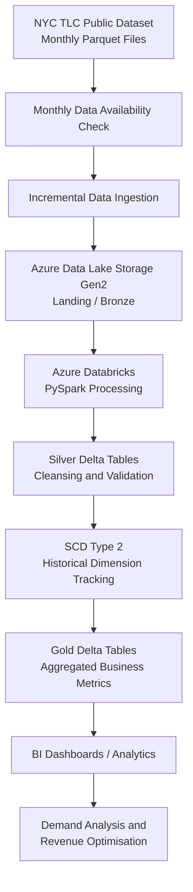
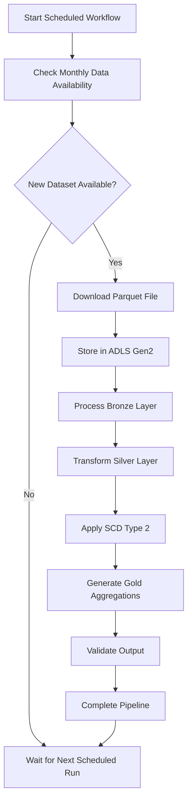

 <div align="center">

# 🚕 Enterprise Mobility Data Engine
### End-to-End Incremental Data Engineering Pipeline with Azure Databricks & Unity Catalog

A data engineering platform built with Azure Databricks, PySpark, Delta Lake and Azure Data Lake Storage Gen2 (ADLS Gen2) to automate the ingestion, transformation and analysis of large-scale NYC taxi trip records.

The platform processes approximately 3.8–5 million records per monthly dataset, implementing incremental ingestion, SCD Type 2 historical tracking and a Bronze-Silver-Gold Medallion Architecture to transform raw mobility data into actionable business intelligence.

The ultimate goal is to provide a reliable historical data foundation for analysing taxi demand, geographical revenue patterns, driver opportunities and future mobility trends.

<p>
  
  
  
  
  
</p>

</div>

<hr/>

## 📑 Table of Contents

1. [Project Overview](#-1-project-overview)
2. [Business Problem](#-2-business-problem)
3. [Project Objectives](#-3-project-objectives)
4. [Dataset Overview](#-4-dataset-overview)
5. [Solution Architecture](#-5-solution-architecture)
6. [Data Ingestion](#-6-data-ingestion)
7. [Data Transformation and Processing](#-7-data-transformation-and-processing)
8. [Storage and Data Modelling](#-8-storage-and-data-modelling)
9. [Data Orchestration](#-9-data-orchestration)
10. [Security and Governance](#-10-security-and-governance)
11. [Analytics and Business Intelligence](#-11-analytics-and-business-intelligence)
12. [Performance Optimisation](#-12-performance-optimisation)
13. [Data Quality and Reliability](#-13-data-quality-and-reliability)
14. [Repository Structure](#-14-repository-structure)
15. [Prerequisites](#-15-prerequisites)
16. [Setup and Execution](#-16-setup-and-execution)
17. [Business Applications](#-17-business-applications)
18. [Future Enhancements](#-18-future-enhancements)
19. [Technology Stack](#-19-technology-stack)
20. [Data Source and References](#-20-data-source-and-references)

---

## 🚀 1. Project Overview

The Enterprise Mobility Data Engine is designed to automate the processing of publicly available NYC Taxi & Limousine Commission (TLC) trip record data.

NYC TLC publishes monthly taxi trip datasets, typically making data available approximately two months after the corresponding trip month.

For example, September 2026 trip data became available in November 2026.

Instead of manually downloading and processing every monthly dataset, this platform identifies newly available data, downloads the corresponding Parquet files into ADLS Gen2 and incrementally processes them using Azure Databricks.

The processing workflow follows a Medallion Architecture:

- **Bronze:** Raw monthly taxi trip data.
- **Silver:** Cleansed, validated and historically managed datasets.
- **Gold:** Aggregated business metrics and analytics-ready datasets.

SCD Type 2 is implemented to maintain historical changes in dimension data, while Delta Lake provides reliable storage and supports efficient analytical processing.

The resulting Gold datasets enable business users to explore geographical demand, trip volumes, fare distributions and revenue trends.

### Key Project Highlights

| Capability | Implementation |
|---|---|
| Data source | NYC TLC Trip Record Data |
| Monthly data volume | Approximately 3.8–5 million rows |
| File format | Parquet |
| Data ingestion | Incremental monthly ingestion |
| Cloud storage | Azure Data Lake Storage Gen2 |
| Processing engine | Azure Databricks / PySpark |
| Data architecture | Bronze, Silver and Gold |
| Historical tracking | SCD Type 2 |
| Storage format | Delta Lake |
| Orchestration | Databricks Workflows |
| Governance | Unity Catalog |
| Optimisation | Partitioning, Z-Ordering and Liquid Clustering |

---

## 🎯 2. Business Problem

NYC TLC publishes large monthly Parquet files containing millions of taxi trip records.

Although these datasets provide valuable information about taxi operations, extracting meaningful business insights from raw files presents several challenges.

**Key challenges:**

1. **Recurring Data Releases:** New datasets become available monthly, requiring a reliable mechanism to identify and ingest newly published files.
2. **Large Data Volumes:** Processing millions of records repeatedly can introduce unnecessary computation and inefficient resource utilisation.
3. **Historical Data Management:** Changes in reference dimensions, such as taxi zone information, need to be tracked without losing historical context.
4. **Data Quality:** Raw trip records may contain missing values, invalid fares, inconsistent schemas and duplicate business records.
5. **Analytical Performance:** Raw transactional data is not directly suitable for efficient business reporting and geographical trend analysis.
6. **Business Visibility:** Organisations need a structured way to identify high-demand areas, revenue opportunities and locations with lower taxi activity.

### The Proposed Solution

Build an automated incremental data platform that processes newly available monthly datasets, maintains historical records and produces analytics-ready business metrics.

This reduces the need for manual data preparation and creates a foundation for future demand forecasting, fleet optimisation and location-based marketing strategies.

---

## 🎯 3. Project Objectives

The main objectives of this project are:

- Automate monthly data discovery and ingestion from the NYC TLC public dataset.
- Store raw Parquet files in Azure Data Lake Storage Gen2.
- Implement incremental processing to load newly available datasets.
- Build a scalable Medallion Architecture using Azure Databricks.
- Develop PySpark transformations for data cleansing, validation and standardisation.
- Implement SCD Type 2 for historical dimension tracking.
- Store structured datasets in Delta Lake.
- Optimise analytical workloads through appropriate data organisation and clustering.
- Orchestrate pipeline execution using Databricks Workflows.
- Produce aggregated Gold datasets for business intelligence and mobility analytics.

---

## 📊 4. Dataset Overview

**Source:** NYC Taxi & Limousine Commission (TLC) Trip Record Data.

Official source: https://www.nyc.gov/site/tlc/about/tlc-trip-record-data.page

The dataset contains detailed records of taxi trips, including pickup and drop-off information, passenger counts, trip distances, payment details and fare information.

### Dataset Characteristics

| Attribute | Description |
|---|---|
| Data provider | NYC Taxi & Limousine Commission |
| Data frequency | Monthly |
| File format | Parquet |
| Approximate monthly records | 3.8M–5M |
| Approximate columns | 21 |
| Data type | Structured transactional data |
| Historical availability | Multiple years of trip records |

### Important Dataset Fields

| Column | Description |
|---|---|
| VendorID | Taxi technology provider identifier |
| tpep_pickup_datetime | Trip pickup timestamp |
| tpep_dropoff_datetime | Trip drop-off timestamp |
| passenger_count | Number of passengers |
| trip_distance | Total trip distance |
| RatecodeID | Rate code identifier |
| PULocationID | Pickup taxi zone identifier |
| DOLocationID | Drop-off taxi zone identifier |
| payment_type | Payment method identifier |
| fare_amount | Base trip fare |
| extra | Additional charges |
| mta_tax | MTA tax |
| tip_amount | Tip amount |
| tolls_amount | Toll charges |
| improvement_surcharge | Improvement surcharge |
| total_amount | Total trip amount |
| congestion_surcharge | Congestion surcharge |
| Airport_fee | Airport-related fee |

*Note: The exact available columns can vary depending on the taxi service type and publication period. The fields above represent examples from the yellow taxi trip dataset.*

### Incremental Data Availability

The ingestion process follows the TLC publication schedule.

Example:

| Processing month | Target trip dataset |
|---|---|
| November 2026 | September 2026 |
| December 2026 | October 2026 |
| January 2027 | November 2026 |
| February 2027 | December 2026 |

The pipeline is designed to identify the relevant historical month instead of assuming that the latest calendar month is immediately available.

---

## 🏗️ 5. Solution Architecture

The platform follows a cloud-based Lakehouse architecture using Azure Data Lake Storage Gen2, Azure Databricks, Delta Lake and Unity Catalog.

### End-to-End Architecture



### Architecture Workflow

1. **Source Identification:** Check the NYC TLC publication page for the expected monthly dataset.
2. **Incremental Ingestion:** Identify and download newly available Parquet files.
3. **Bronze Storage:** Preserve the original source data in ADLS Gen2.
4. **Silver Transformation:** Clean, validate, standardise and deduplicate trip records.
5. **Historical Management:** Apply SCD Type 2 to maintain historical dimension changes.
6. **Gold Aggregation:** Calculate business metrics and geographical performance indicators.
7. **Analytics:** Expose structured datasets for reporting and future predictive analytics.

The architecture separates raw ingestion, data transformation and analytical modelling to improve maintainability, scalability and data traceability.

---

## 📥 6. Data Ingestion

The ingestion layer is responsible for automatically identifying and retrieving newly published monthly taxi datasets.

### 6.1 Monthly Data Discovery

The pipeline checks the NYC TLC publication page to identify the expected dataset based on the two-month publication delay.

For example:

- Current processing month: November 2026.
- Expected trip data: September 2026.
- Target file: September 2026 monthly Parquet dataset.

The ingestion process checks whether the relevant dataset is available before initiating the download.

### 6.2 Incremental Ingestion

Instead of reprocessing all historical files, the pipeline identifies newly available monthly datasets and processes them incrementally.

The ingestion workflow:

1. Determine the target trip month.
2. Check the source for the corresponding Parquet file.
3. Verify whether the dataset has already been processed.
4. Download the new file when available.
5. Store the raw file in the ADLS Gen2 landing area.
6. Update the ingestion processing status.

### 6.3 Landing Zone Structure

Example storage organisation:

```text
ADLS_Gen2/
│
└── landing/
    │
    └── yellow_taxi/
        │
        ├── year=2026/
        │   ├── month=07/
        │   │   └── yellow_tripdata_2026-07.parquet
        │   │
        │   ├── month=08/
        │   │   └── yellow_tripdata_2026-08.parquet
        │   │
        │   └── month=09/
        │       └── yellow_tripdata_2026-09.parquet
```

This organisation makes historical datasets easier to identify, maintain and process.

### 6.4 Idempotent Processing

Ingestion processing flags and dataset tracking are used to manage recurring execution cycles.

This helps ensure that already processed monthly datasets are not unnecessarily ingested again.

---

## ⚙️ 7. Data Transformation and Processing

Azure Databricks and PySpark are used to process large volumes of trip data through distributed Spark transformations.

### 7.1 Bronze Layer

The Bronze layer preserves the ingested source data.

Responsibilities:

- Store original monthly Parquet datasets.
- Maintain source-level data traceability.
- Preserve historical raw records.
- Retain ingestion metadata where available.

The Bronze layer acts as the initial reference point for downstream transformations.

### 7.2 Silver Layer

The Silver layer converts raw trip records into structured and reliable datasets.

Implemented transformation activities include:

**Data Cleansing**
- Handle missing and null values.
- Validate pickup and drop-off timestamps.
- Identify invalid passenger counts and trip distances.
- Validate fare and payment-related fields.

**Schema Validation**
- Enforce expected data types.
- Standardise column names and formats.
- Validate incoming schemas against the expected structure.

**Deduplication**
- Identify duplicate business records.
- Apply appropriate deduplication rules.

**Business Logic**
- Derive trip duration.
- Standardise date and time attributes.
- Prepare location identifiers for geographical analysis.
- Validate transactional fields before downstream aggregation.

### 7.3 SCD Type 2 Historical Tracking

Slowly Changing Dimension Type 2 is implemented to preserve historical changes in dimension records.

This is particularly useful for reference data such as taxi zone information, where geographical descriptions or classifications may change over time.

Instead of overwriting an existing dimension record, SCD Type 2 maintains historical versions.

Example:

| Zone ID | Zone Name | Valid From | Valid To | Current |
|---|---|---|---|---|
| 100 | Old Zone Name | 2025-01-01 | 2026-06-30 | No |
| 100 | Updated Zone Name | 2026-07-01 | 9999-12-31 | Yes |

*Illustrative example of historical versioning.*

Typical SCD Type 2 attributes include:

- Business key.
- Effective start date.
- Effective end date.
- Current record indicator.
- Historical version information.

When a tracked attribute changes, the previous record is expired and a new current version is created.

**Business benefit:** Historical taxi trip records can be analysed using the relevant version of reference data rather than losing historical context when dimensions change.

---

## 🗄️ 8. Storage and Data Modelling

Delta Lake is used as the primary storage format for structured datasets.

The platform separates data into three logical layers.

### Medallion Architecture

| Layer | Purpose | Storage |
|---|---|---|
| Bronze | Raw source data | Parquet / Delta |
| Silver | Cleansed and validated records | Delta Lake |
| Gold | Aggregated business metrics | Delta Lake |

### Bronze

Preserves raw source records and supports historical traceability.

### Silver

Contains validated trip records, standardised schemas and historically managed dimensions.

### Gold

Contains aggregated datasets designed for analytical consumption.

Example Gold data models:

```text
Gold/
│
├── fact_trip_metrics
│
├── agg_trip_demand
│
├── agg_revenue_by_zone
│
├── agg_fare_analysis
│
└── agg_monthly_trip_summary
```

These represent proposed logical analytical outputs and can be adjusted to match the actual implemented tables.

### Unity Catalog

Unity Catalog is used for centralised metadata management, data discovery and governance across the Databricks environment.

It supports the organisation and management of data assets across the Lakehouse.

---

## 🔄 9. Data Orchestration

Databricks Workflows and Jobs manage the execution of ingestion and transformation tasks.

The workflow coordinates the processing sequence and ensures that downstream tasks execute after their dependencies are completed.

### Pipeline Execution Sequence



### Orchestration Capabilities

- Scheduled pipeline execution.
- Task dependency management.
- Automated retries for supported failures.
- Cluster auto-scaling.
- Execution monitoring and logging.
- Pipeline status tracking.

This orchestration approach reduces manual intervention and supports recurring monthly processing.

---

## 🔐 10. Security and Governance

Data governance and access management are implemented using Unity Catalog and Azure identity integration.

### Unity Catalog

Provides centralised management of:

- Data assets and metadata.
- Table permissions.
- Data discovery.
- Data lineage.
- Access policies.

### Access Control

Granular access permissions can be applied to control who can access specific datasets and sensitive columns.

Where required, row-level and column-level security policies can restrict access to particular records or attributes.

### Azure Managed Identity

Managed identity integration supports secure access between Azure Databricks and ADLS Gen2 without relying on hardcoded storage credentials.

### Data Lineage

Unity Catalog lineage helps track data dependencies and understand how source datasets flow into downstream analytical tables.

---

## 📈 11. Analytics and Business Intelligence

The Gold layer transforms transactional taxi trip data into aggregated metrics that support operational and commercial decision-making.

### Key Business Metrics

| Metric | Description |
|---|---|
| Total Trips | Total number of completed trips |
| Average Passengers | Average passengers per trip |
| Average Trip Distance | Mean distance travelled |
| Average Fare | Average base fare per trip |
| Minimum Fare | Lowest recorded fare |
| Maximum Fare | Highest recorded fare |
| Total Revenue | Aggregated trip revenue |

### Geographical Analytics

Taxi zone identifiers can be used to analyse geographical mobility patterns.

Examples:

- Trips by pickup zone.
- Trips by drop-off zone.
- Revenue by geographical zone.
- Average fare by pickup location.
- High-demand and low-demand areas.
- Monthly changes in geographical demand.

### Example Business Questions

The analytical datasets can help answer questions such as:

1. Which taxi zones generate the highest trip revenue?
2. Which areas experience the highest taxi demand?
3. Which locations have lower trip volumes?
4. Which pickup zones generate higher average fares?
5. How does trip demand change from month to month?
6. Which areas may present better earning opportunities for taxi drivers?

### Potential Business Impact

**Driver Opportunity Analysis**

Identify locations with higher trip volumes and revenue patterns to help taxi drivers make more informed decisions about where to operate.

**Location-Based Promotions**

Identify areas with relatively low taxi demand and help businesses plan targeted promotional campaigns to stimulate activity.

**Fleet Deployment**

Support fleet allocation decisions by identifying locations with changing demand patterns.

**Demand Forecasting**

Provide historical datasets for future forecasting models that can predict demand based on geographical, seasonal and temporal patterns.

**Revenue Optimisation**

Analyse geographical fare and revenue trends to identify potential revenue opportunities.

The platform establishes the data foundation for these capabilities. Actual operational improvements would require further business validation and, where appropriate, predictive modelling.

---

## ⚡ 12. Performance Optimisation

The platform incorporates Delta Lake optimisation techniques to improve data organisation and analytical query efficiency.

### Delta Partitioning

Partitioning organises data based on selected attributes, such as trip date or year and month.

Benefits:

- Supports partition pruning.
- Reduces unnecessary data scanning for suitable queries.
- Improves access to date-specific datasets.

### Z-Ordering

Z-Ordering co-locates related data values to improve data skipping for queries that filter on frequently accessed columns.

Potential benefits:

- More efficient data skipping.
- Reduced unnecessary file scanning.
- Improved analytical query efficiency.

### Liquid Clustering

Liquid Clustering provides a flexible approach to organising Delta tables around selected clustering columns.

It can help maintain data organisation as datasets grow and evolve.

### Query Performance

The combination of Delta Lake storage, suitable partitioning and data organisation techniques provides a foundation for efficient analytical workloads.

Performance improvements should be validated through execution-time comparisons, query profiles and Spark execution metrics rather than assumed from the optimisation configuration alone.

---

## ✅ 13. Data Quality and Reliability

Data quality checks are applied throughout the processing pipeline to maintain reliable downstream datasets.

### Validation Areas

| Validation | Purpose |
|---|---|
| Schema validation | Ensure expected column structures and data types |
| Null checks | Identify missing critical values |
| Duplicate checks | Identify duplicate trip records |
| Timestamp validation | Validate pickup and drop-off chronology |
| Fare validation | Identify invalid fare values |
| Passenger validation | Check passenger count constraints |
| Trip distance validation | Identify invalid distance values |
| SCD Type 2 validation | Ensure correct historical version management |

### Pipeline Reliability

Additional reliability mechanisms include:

- Ingestion status tracking.
- Idempotent processing.
- Workflow retry policies.
- Processing logs.
- Validation of downstream outputs.
- Historical source retention.

These controls help maintain consistent processing across recurring monthly executions.

---

## 📁 14. Repository Structure

The following is a recommended GitHub repository organisation for this project.

```text
Enterprise-Mobility-Data-Engine/
│
├── README.md
│
├── architecture/
│   ├── architecture_diagram.png
│   └── pipeline_workflow.png
│
├── config/
│   ├── dev_config.json
│   └── prod_config.json
│
├── ingestion/
│   ├── monthly_data_discovery.py
│   ├── download_trip_data.py
│   └── ingestion_tracking.py
│
├── notebooks/
│   ├── 01_bronze_ingestion.py
│   ├── 02_silver_transformation.py
│   ├── 03_scd_type_2.py
│   └── 04_gold_aggregation.py
│
├── transformations/
│   ├── data_cleaning.py
│   ├── schema_validation.py
│   └── business_transformations.py
│
├── data_modelling/
│   ├── dimension_tables.py
│   ├── fact_tables.py
│   └── gold_metrics.py
│
├── orchestration/
│   └── databricks_workflow_config.json
│
├── optimisation/
│   ├── partitioning.py
│   ├── z_ordering.py
│   └── liquid_clustering.py
│
├── governance/
│   └── unity_catalog_setup.sql
│
├── tests/
│   ├── test_data_quality.py
│   ├── test_schema_validation.py
│   └── test_scd_type_2.py
│
└── docs/
    ├── data_dictionary.md
    └── implementation_notes.md
```

*This is a suggested structure. Adjust the folders and filenames to reflect the actual files in your repository.*

---

## 🛠️ 15. Prerequisites

To reproduce or extend this project, the following services and tools are required:

| Requirement | Purpose |
|---|---|
| Microsoft Azure Account | Cloud infrastructure |
| Azure Data Lake Storage Gen2 | Raw and processed data storage |
| Azure Databricks Workspace | Data engineering and Spark processing |
| Apache Spark | Distributed data processing |
| PySpark | Data transformations |
| Delta Lake | Reliable analytical storage |
| Unity Catalog | Data governance |
| Databricks Workflows | Pipeline orchestration |
| Python | Supporting ingestion and processing logic |

### Required Knowledge

- Python and PySpark.
- SQL and relational data modelling.
- Apache Spark fundamentals.
- Delta Lake.
- Medallion Architecture.
- Incremental data processing.
- Slowly Changing Dimensions.
- Azure storage and cloud security.

---

## 🚀 16. Setup and Execution

The following steps describe the general deployment and execution process. Adapt the configuration names and notebook paths to your implementation.

### Step 1: Clone the Repository

```bash
git clone https://github.com/YOUR_USERNAME/Enterprise-Mobility-Data-Engine.git

cd Enterprise-Mobility-Data-Engine
```

### Step 2: Configure Azure Storage

Create an Azure Data Lake Storage Gen2 account and configure the required containers or directories.

Example:

```text
storage-account/
│
├── landing/
├── bronze/
├── silver/
└── gold/
```

Configure the required authentication method and grant the Databricks environment appropriate access permissions.

### Step 3: Configure Databricks

Set up an Azure Databricks workspace and configure:

- Compute resources.
- Spark environment.
- Unity Catalog.
- Storage access.
- Required permissions.

### Step 4: Configure Pipeline Parameters

Configure the storage paths, source information and processing parameters.

Example configuration:

```json
{
  "source": "NYC_TLC",
  "taxi_type": "yellow",
  "file_format": "parquet",
  "storage_account": "<storage-account>",
  "landing_path": "<landing-path>",
  "bronze_path": "<bronze-path>",
  "silver_path": "<silver-path>",
  "gold_path": "<gold-path>",
  "processing_mode": "incremental"
}
```

This is an illustrative configuration template; replace the placeholders with your actual environment settings.

### Step 5: Execute Data Ingestion

Run the monthly data discovery and ingestion process.

The pipeline should:

1. Determine the expected trip month.
2. Check dataset availability.
3. Identify unprocessed files.
4. Download available Parquet files.
5. Store files in ADLS Gen2.

### Step 6: Execute Transformation Workflows

Run the Databricks notebooks or workflow tasks in the correct order:

```text
01. Bronze Ingestion
        |
        v
02. Silver Transformation
        |
        v
03. SCD Type 2 Processing
        |
        v
04. Gold Aggregation
        |
        v
05. Data Quality Validation
```

### Step 7: Validate Gold Datasets

Verify that the aggregated datasets contain the expected metrics and that the transformations have completed successfully.

Example SQL:

```sql
SELECT
    COUNT(*) AS total_records,
    SUM(total_amount) AS total_revenue,
    AVG(passenger_count) AS avg_passengers,
    AVG(trip_distance) AS avg_trip_distance,
    AVG(fare_amount) AS avg_fare,
    MIN(fare_amount) AS min_fare,
    MAX(fare_amount) AS max_fare
FROM gold_trip_metrics;
```

*Adjust the table and column names to match your actual Gold model.*

---

## 💼 17. Business Applications

This project demonstrates how cloud-based data engineering can transform raw mobility records into information that supports business decisions.

| Business Area | Potential Application |
|---|---|
| Driver Earnings | Identify high-revenue taxi zones |
| Demand Analysis | Understand geographical trip demand |
| Marketing | Target lower-demand locations with promotions |
| Fleet Management | Support geographical fleet allocation |
| Revenue Analysis | Compare revenue across taxi zones |
| Predictive Analytics | Build historical datasets for demand forecasting |

### Long-Term Business Value

The platform can be extended beyond historical reporting into predictive mobility analytics.

By combining historical trip records with additional data sources such as weather, public events, traffic conditions and seasonal trends, the platform could support more advanced demand prediction and operational planning.

---

## 🔮 18. Future Enhancements

Potential extensions to the platform include:

- **Predictive Demand Forecasting:** Develop machine learning models to predict taxi demand by location and time.
- **Interactive Power BI Dashboards:** Build geographical dashboards for trip volumes, revenue trends and taxi zone performance.
- **Weather Data Integration:** Combine weather information with trip records to understand how weather conditions influence demand.
- **Real-Time Analytics:** Extend the architecture to support streaming mobility data.
- **Advanced Geospatial Analytics:** Analyse pickup and drop-off patterns, geographical hotspots and travel corridors.
- **Automated Performance Monitoring:** Track Spark execution metrics, processing duration and resource utilisation.
- **CI/CD Integration:** Introduce automated deployment and testing workflows for Databricks notebooks and supporting code.

---

## 🧰 19. Technology Stack

| Category | Technologies |
|---|---|
| Cloud Platform | Microsoft Azure |
| Cloud Storage | Azure Data Lake Storage Gen2 |
| Data Engineering | Azure Databricks |
| Programming | Python, PySpark, SQL |
| Processing Engine | Apache Spark |
| Storage Format | Apache Parquet, Delta Lake |
| Architecture | Medallion Architecture |
| Data Modelling | Fact and Dimension Modelling, SCD Type 2 |
| Orchestration | Databricks Workflows and Jobs |
| Governance | Unity Catalog |
| Performance | Partitioning, Z-Ordering, Liquid Clustering |
| Security | Azure Managed Identity, RBAC |

---

## 📚 20. Data Source and References

**Primary Data Source**

NYC Taxi & Limousine Commission (TLC) Trip Record Data:

https://www.nyc.gov/site/tlc/about/tlc-trip-record-data.page

The datasets are publicly available and provide historical information about taxi trips in New York City.

**Technology Documentation**

- [Azure Databricks Documentation](https://learn.microsoft.com/en-us/azure/databricks/)
- [Azure Data Lake Storage Gen2](https://learn.microsoft.com/en-us/azure/storage/blobs/data-lake-storage-introduction)
- [Apache Spark Documentation](https://spark.apache.org/docs/latest/)
- [Delta Lake Documentation](https://docs.delta.io/)
- [Unity Catalog Documentation](https://learn.microsoft.com/en-us/azure/databricks/data-governance/unity-catalog/)
- [Databricks Workflows Documentation](https://learn.microsoft.com/en-us/azure/databricks/jobs/)

---

## 👨‍💻 Project Summary

The Enterprise Mobility Data Engine demonstrates the implementation of an end-to-end cloud data engineering solution using Microsoft Azure and Databricks.

By combining automated incremental ingestion, distributed PySpark transformations, SCD Type 2 historical tracking, Delta Lake storage and a Medallion Architecture, the platform converts large-scale monthly taxi trip records into structured and analytics-ready datasets.

Beyond data processing, the solution establishes a foundation for geographical demand analysis, driver opportunity identification, revenue optimisation, fleet planning and future predictive mobility analytics.

**Built with a focus on scalability, automation, historical data integrity and business value.**
